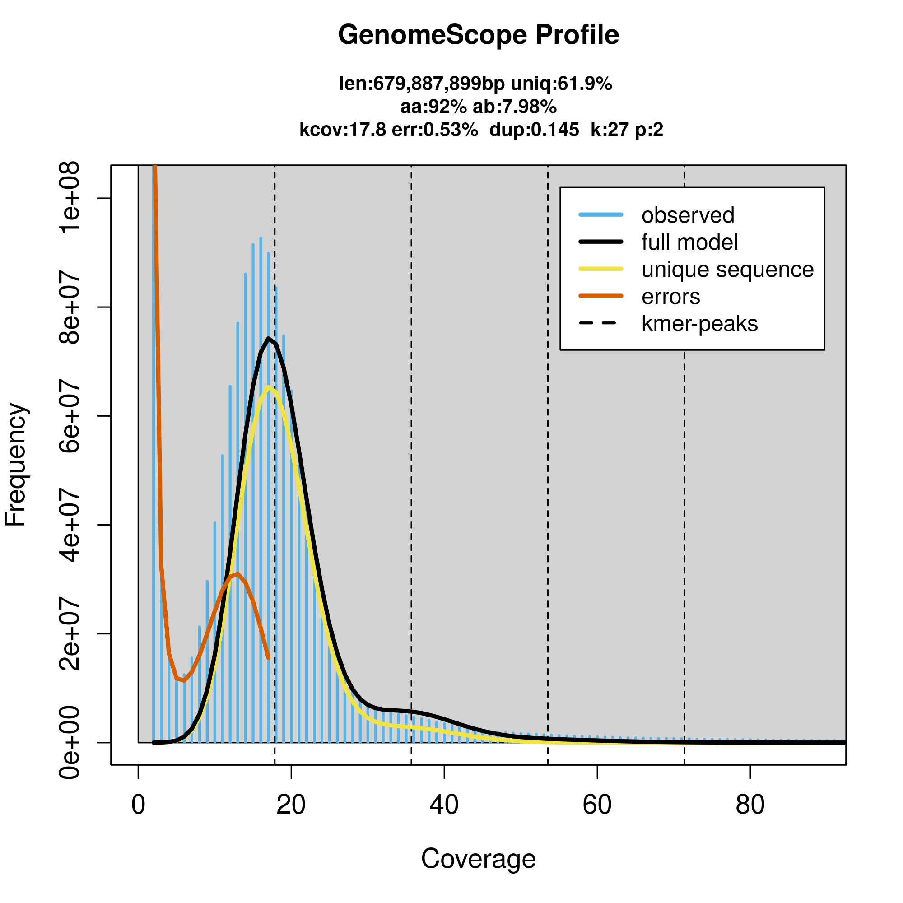
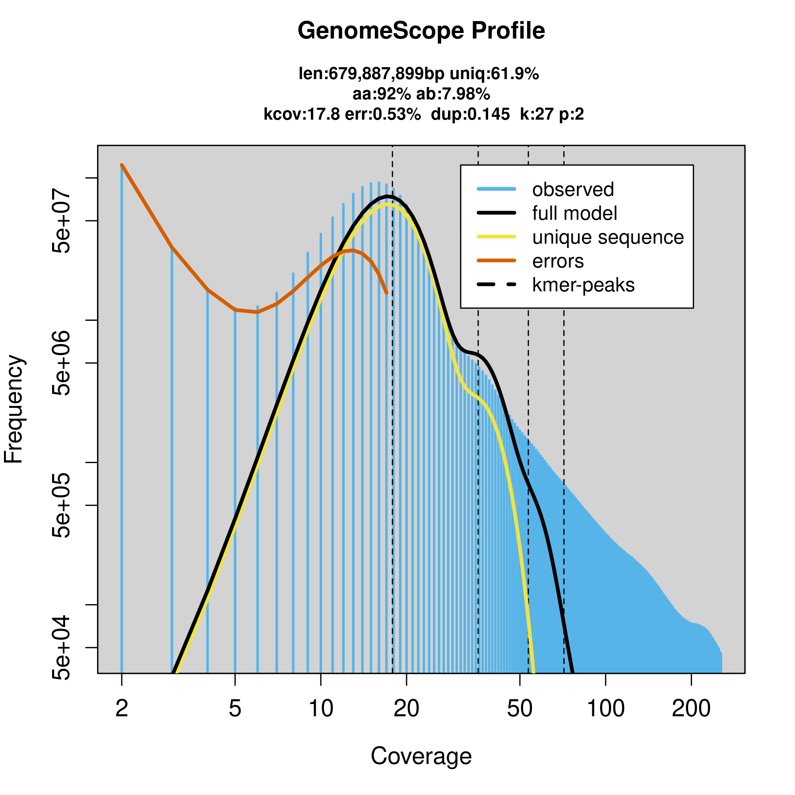
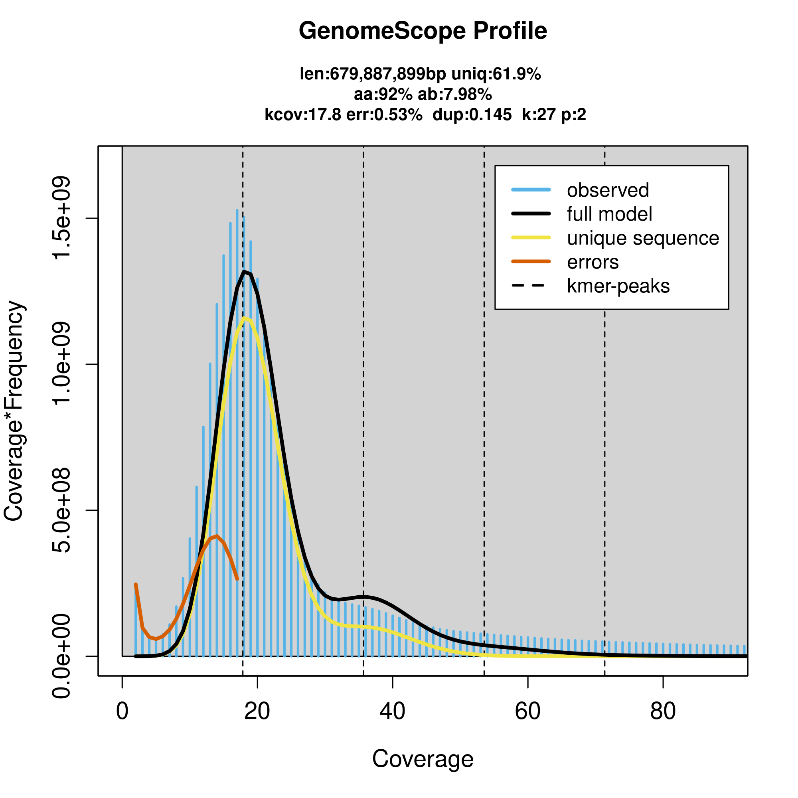
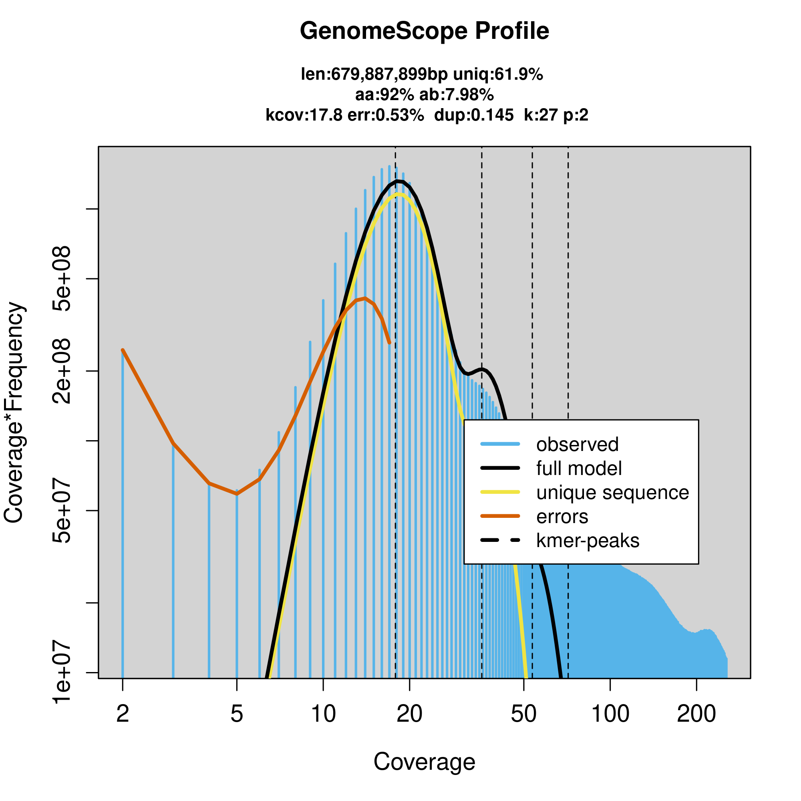

# Nanopore MinIon data

Isa send me the data from Nanopore MinIon and PacBio the 28th of
November. I have been uploading the data to the server, and organizing
them by the species which belongs. I'm going to detail here the "notes"
that Isa told me about the data, and some things that we need to
consider when analize the data.

First, MinIon machine returns the sequences in fast5 format (rawdata),
and then, we need to do a base calling in those files, returning the
FASTQ files that we are interested in. Base calling is the process of
converting the electrical signals generated by DNA or RNA strand passing
through the nanopore into the corresponding base sequence of the strand.
The raw data is a direct measurement of the changes in ionic current as a
DNA/RNA strand passes through the pore, which are recorded by the
MinKNOW software. MinIon also processes the signal into "reads", each
read corresponding to a single strand of DNA/RNA. These reads are
optionally written out as .fast5 files.

We are going to perform the base calling with Guppy, a data processing
toolkit that contains the Oxford Nanopore base calling algorithms and
several post-processing features. The input is the raw data in .fast5
format.

In the data folder of this project, we have one folder with raw data
of MinIon for two(?) individuals of *Crepidostomum*.
`Ex68_3_Crepi` corresponds to two(?) pooled individuals. In that folder, we have
the data in fast5 and FASTQ format. We are going to use the fast5 data for
the base calling. There are 153 fast5 files. In the *Phyllodistomum* project
we already compared the qualities of original (received) FASTQ files and
those produced after our own base calling with Guppy, and we noted an
improvement of the quality with our base calling. The reason may be that
Guppy can be run in different modes, more or less accurate. We suspect
that the original FASTQ files in `../../data/Nanopore_MinIon/Ex68_3_Crepi/fastq_pass`
were produced with lower accuracy, maybe on the fly, during sequencing.

# Base-calling
We execute `guppy_basecaller` tool from Guppy for the basecalling of
the rawdata.

```{bash basecalling}
FAST5=../../data/Nanopore_MinIon/Ex68_3_Crepi/fast5_pass
if [ ! -e nanopore/sequencing_summary.txt ]; then
   guppy_basecaller -i $FAST5 -s nanopore \
                    --config dna_r9.4.1_450bps_hac.cfg \
                    -q 0 --recursive --compress_fastq \
                    --num_callers 2 --cpu_threads_per_caller 16
fi

# Remove log files reporting neither errors nor success.
for file in $(ls -1 nanopore/*.log); do
   if ! grep -i -e "success" -e "error" $file; then
      rm $file
   fi
done
```

```{r summaryBasecalling}
library(ggplot2)
summarySeq <- read.table('nanopore/sequencing_summary.txt', header=TRUE)
ggplot(data = summarySeq,
       mapping = aes(x = sequence_length_template,
                     y = mean_qscore_template,
                     color = passes_filtering)) +
  geom_point() + scale_x_continuous(trans = 'log')
```

There are many very long reads, as well as short ones. The quality is modest.

# Quality control of Nanopore data after base calling

```{r NanoporeQC, fig.show="hold", out.width="50%", message=FALSE, warning=FALSE}
library(fastqcr)

if (! file.exists('report_NP')) {
  fastqc(fq.dir = 'nanopore', qc.dir = "report_NP",
         threads = 40, fastqc.path = "/usr/local/bin/fastqc")
}

qc.file <- list.files(path = "report_NP", all.files = FALSE,
                      full.names = TRUE, pattern = "zip")
nb_samples <- length(qc.file)

modules <- c(
  "Per sequence GC content",
  "Per base sequence quality",
  "Per sequence quality scores"
)
qc <- qc_read_collection(qc.file, sample_names = paste('S', 1:nb_samples, sep = ''),
       modules = modules)
qc_plot_collection(qc, modules = modules)
plot(density(summarySeq$sequence_length_template),
     main = 'Read length distribution', xlim = c(0, 25000))
text(10000, 0.0001,
     sprintf("%.0f reads\nwith %.0f bases in total.",
             dim(summarySeq)[1],
             sum(summarySeq$sequence_length_template)))
```

The figure suggests the first 9 or 10 bases of every Nanopore read should be removed.
Actually, the first average quality above 20 in the figure is an average of several
positions. Removing the first 40 bases is actually a better way to make sure that all
reads start with high quality bases.

# Trimming of Nanopore reads

```{bash trimming}
if [ ! -d nanopore_trimmed ]; then mkdir nanopore_trimmed; fi
for INPUT in $(ls -1 nanopore/*.fastq); do
   OUTPUT=$(printf "nanopore_trimmed/%s" $(basename $INPUT))
   if [ ! -e $OUTPUT ]; then
      vsearch --fastq_filter $INPUT \
              --fastq_stripleft 41 \
              --fastq_minlen 35 \
              --fastq_qmax 93 \
              --fastqout $OUTPUT \
              --threads 16 \
              1> nanopore_trimmed/vsearch.log \
              2> nanopore_trimmed/vsearch.err &
   fi
done
wait

if [ ! -e nanopore_trimmed/lengthHisto.txt ]; then
   gawk '(NR % 4 == 2){
      F[length($1)]++
   }END{
      for (f in F) print f "\t" F[f]
   }' nanopore_trimmed/*.fastq | \
   sort -nk 1,1 > nanopore_trimmed/lengthHisto.txt
fi
```

```{r trimmedQC, fig.show="hold", out.width="50%", message=FALSE, warning=FALSE}
if (! file.exists('report_NPtrimmed')) {
  fastqc(fq.dir = 'nanopore_trimmed', qc.dir = "report_NPtrimmed",
         threads = 40, fastqc.path = "/usr/local/bin/fastqc")
}

qc.file <- list.files(path = "report_NPtrimmed", all.files = FALSE,
                      full.names = TRUE, pattern = "zip")
nb_samples <- length(qc.file)

modules <- c(
  "Per sequence GC content",
  "Per base sequence quality",
  "Per sequence quality scores"
)
qc <- qc_read_collection(qc.file, sample_names = paste('S', 1:nb_samples, sep = ''),
       modules = modules)
qc_plot_collection(qc, modules = modules)

lengthHisto <- read.table('nanopore_trimmed/lengthHisto.txt',
                          col.names = c('Length', 'Freq'))
plot(lengthHisto$Length, lengthHisto$Freq, type = 'l',
     main = 'Trimmed-read length distribution',
     xlim = c(0, 25000))

text(10000, 175,
     sprintf("%.0f reads\nwith %.0f bases in total.",
             dim(summarySeq)[1],
             sum(summarySeq$sequence_length_template)))
```

# PacBio data

The data structure of PACBio is somewhat different from that of
Nanopore. Here, the data is organized in a single 324.4Mb fastq.gz
compressed file. At first, I'm not going to unzip the file for reasons
of disk space, plus most of the programs I'm going to use in the
pipeline accept compressed files as input.

In this case, we also have two different individuals of *Crepidostomum*
(which are not the same as those of Nanopore!). I'm going to perform the
quality analysis in the sequences fastq.gz file provided by Isa.

File name: demultiplex.bc1018_BAK8B_OA--bc1018_BAK8B_OA.hifi_reads.fastq.gz

```{r Pacbio_QC, fig.show="hold", out.width="50%", message=FALSE, warning=FALSE}
library(fastqcr)
library(ShortRead)
PACBIO <- '../../data/PacBio/fastqs/'

if (! file.exists('report_PB')) {
  fastqc(fq.dir = PACBIO, qc.dir = "report_PB",
         threads = 40, fastqc.path = "/usr/local/bin/fastqc")
}
qc.files <- list.files(path = "report_PB", all.files = FALSE,
                       full.names = TRUE, pattern = "zip")
nb_samples <- length(qc.files)

modules <- c(
  "Per sequence GC content",
  "Per base sequence quality",
  "Per sequence quality scores"
)
qc <- qc_read_collection(qc.files, sample_names = paste('S', 1:nb_samples, sep = ''),
       modules = modules)
qc_plot_collection(qc, modules = modules)

fq <- '../../data/PacBio/fastqs'
pacbio <- readFastq(fq, withIds = FALSE)
#barplot(table(width(pacbio)), xlab = 'Read length', ylab = 'Frequency', las = 2)
plot(density(width(pacbio)))
text(10000, 0.0003,
     sprintf("%.0f reads\nwith %i total bases", length(pacbio), sum(width(pacbio))))
```

# Shotgun Illumina data
## Data structure
In this case, we have the data also in fastq.gz compressed format.
Specifically, we have two files: 1 and 2, corresponding to the
forward and reverse readings. The same as in the case of PacBio,
I don't unzip the .gz for reasons of space on the disk. It's size
is 17 Gb for the forward and 19 Gb for the reverse.

## K-mer analysis

```{bash kmers}
DATA="../../data/Shotgun_Illumina"

if [ ! -e reads.histo ]; then
   if [ ! -e reads.kmc_suf ]; then
      if [ ! -d kmers ]; then mkdir kmers; fi
      ls $DATA/*.fastq.gz > sg_data
      kmc -k27 -t8 @sg_data reads kmers
      #rm -r kmers
   fi
   kmc_tools transform reads histogram reads.histo
fi

if [ ! -e linear_plot.png ]; then
   if [ ! -e genomescope.R ]; then
      #wget https://raw.githubusercontent.com/schatzlab/genomescope/master/genomescope.R
      wget https://raw.githubusercontent.com/tbenavi1/genomescope2.0/master/genomescope.R
   fi
   chmod u+x genomescope.R
   ./genomescope.R -i reads.histo -o . -k 27
fi
cat model.txt
cat summary.txt
```









## Quality control of illumina data

```{r qc_illumina_shotgun, fig.show='hold', out.width='50%', message=FALSE}
Illumina <- '../../data/Shotgun_Illumina'
if (! file.exists('report_SG')) {
   fastqc(fq.dir = Illumina, qc.dir = 'report_SG',
          threads = 40, fastqc.path = '/usr/local/bin/fastqc')
}
qc.files <- list.files(path = 'report_SG', all.files = FALSE,
                       full.names = TRUE, pattern = 'zip')
nb_samples <- length(qc.files)

modules <- c('Per sequence GC content',
             'Per base sequence quality',
             'Per sequence quality scores')
qc <- qc_read_collection(qc.files, sample_names = paste('S', 1:nb_samples, sep = ''),
                         modules = modules)
qc_plot_collection(qc, modules = modules)
```

# Conclusions

```{r sessionInfo}
sessionInfo()
```
