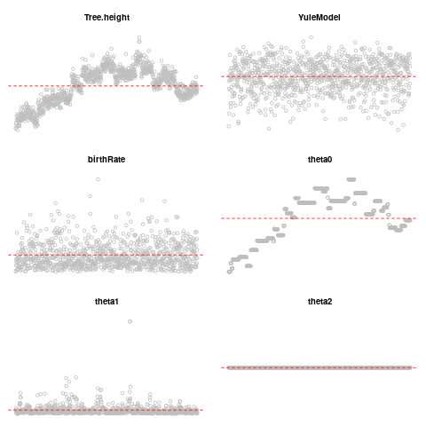
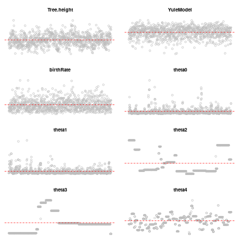

```{r setup, include=FALSE}
knitr::opts_chunk$set(echo = TRUE)
```

The fact that SNAPPER's Path Sampler yielded a Bayes factor supporting
the existence of only one species made no sense in face of the clear
distinction of the two lineages. I suspected a mistake must have been
introduced somewhere in the process.

## Original Path-sampler results
The path sampler with 8 steps produced the following outputs, which were
copied from `/nata/mar/crepidostomum2/results/2025-05-22/ML_chains.txt`
in February 2026:

```
cp2_first 

marginalLs[7 ] = -139640.13757730956

Step        theta         likelihood   contribution ESS
0            1            -19395.9136  0            993.5798     
1            0.5982       -19589.4677  -7803.2019   531.7144     
2            0.3258       -19953.5653  -5348.0692   883.9011     
3            0.1548       -20858.9628  -3418.0958   1001         
4            0.0593       -7785.3035   -413.3176    4.852        
5            0.0154       -4507.7892   -192.9543    1001         
6            0.0015       -23422.2404  -68.5577     215.1753     
7            0            -139640.1376 -39.9271     1001         
sum(ESS) = 5632.2227   

marginal L estimate = -17184.12357512826


cp2_sec

marginalLs[7 ] = -141786.42956210198

Step        theta         likelihood   contribution ESS
0            1            -18715.6841  0            224.5842     
1            0.5982       -18738.6933  -7527.5097   283.286      
2            0.3258       -18840.0756  -5119.2285   5.0375       
3            0.1548       -21948.4429  -3740.8125   4.285        
4            0.0593       -2023.2053   -189.4436    16.725       
5            0.0154       -550.0679    20.0892      2.7115       
6            0.0015       -23533.9297  -293.92      779.8021     
7            0            -141786.4296 -40.6406     901          
sum(ESS) = 2217.4312   

marginal L estimate = -16891.4656263633


cp3_first 

marginalLs[7 ] = -117689.23877146565

Step        theta         likelihood   contribution ESS
0            1            -16262.1594  0            713.9403     
1            0.5982       -16639.8943  -6649.1422   98.5923      
2            0.3258       -17148.4431  -4635.1332   27.2869      
3            0.1548       -17875.6757  -3041.7887   28.3789      
4            0.0593       -19710.7929  -1871.5889   8.7862       
5            0.0154       -19835.4103  -869.0877    11.9639      
6            0.0015       -19698.1366  -44.4195     26.6743      
7            0            -117689.2388 -41.633      815.2533     
sum(ESS) = 1730.8761   

marginal L estimate = -17152.793324410595


c3sp_sec

marginalLs[7 ] = -116886.88046012518

Step        theta         likelihood   contribution ESS
0            1            -16263.1116  0            595.6345     
1            0.5982       -16628.9214  -6643.0501   165.4219     
2            0.3258       -17197.9778  -4657.9574   8.8484       
3            0.1548       -17887.2529  -3027.5665   4.4452       
4            0.0593       -18711.1344  -1755.1999   8.6873       
5            0.0154       -20379.8858  -888.5833    40.392       
6            0.0015       -18333.6354  -49.2611     4.827        
7            0            -116886.8805 -46.6261     901          
sum(ESS) = 1729.2565   

marginal L estimate = -17068.244400399817
```

I manually save the output of individual runs in separate files to look at
them in R. There are also a couple complete runs of the path sampler with 48 steps,
where hybrids were included. They are also copied to text files here, for
easy upload in R. 

```{r}
library(ggplot2)
c2.1 <- read.table('cp2.1.txt', header = TRUE)
c2.1$spn <- 2
c2.1$run <- 'Without hybrids 1'
c2.2 <- read.table('cp2.2.txt', header = TRUE)
c2.2$spn <- 2
c2.2$run <- 'Without hybrids 2'
c2.3 <- read.table('cp2.3.txt', header = TRUE)
c2.3$spn <- 2
c2.3$run <- 'With hybrids'
c3.1 <- read.table('cp3.1.txt', header = TRUE)
c3.1$spn <- 3
c3.1$run <- 'Without hybrids 1'
c3.2 <- read.table('cp3.2.txt', header = TRUE)
c3.2$spn <- 3
c3.2$run <- 'Without hybrids 2'
c3.3 <- read.table('cp3.3.txt', header = TRUE)
c3.3$spn <- 3
c3.3$run <- 'With hybrids'
paths <- rbind(c2.1, c2.2, c2.3, c3.1, c3.2, c3.3)
paths$spn <- factor(paths$spn)
ggplot(paths, aes(x = theta, y = likelihood, color = spn)) +
   geom_line() + geom_point() + facet_wrap(~run)

sapply(split(paths$contribution, list(paths$spn, paths$run)), sum)
```

The reason why the marginal likelihood is higher in the models of two species than
in the models with three species (which is not always the case, by the way) is
the bump at low values of theta, which I think represent distributions closer to
the prior than to the posterior. Let's take a look at the Markov chains. Apparently,
the chains were run for 10 million generations and sampled every 1000 generations.
They include the burn-in. Mean log-likelihood at each step must have been calculated
after excluding a burn-in. The burn-in can be specified when launching the
`PathSampleAnalyser` application. In some cases, 10% seem insufficient. Let's see:

```{r}
source('mcmc.R')
burninpercent <- 10
folder <- '/nata/mar/crepidostomum2/results/2025-05-22/no_hybrids/'
mcmc1 <- lapply(paste0(folder, 'ref_c2sp_first/steps/step', 0:7, '/ref_cp2_first.log'),
                read.table, header = TRUE)
mcmc2 <- lapply(paste0(folder, 'ref_c2sp_second/steps/step', 0:7, '/ref_cp2_second.log'),
                read.table, header = TRUE)
mcmc1 <- lapply(mcmc1,
                function(x) {
                   r <- nrow(x)
                   minr <- round(r * burninpercent / 100)
                   return(x[minr:r,])
                })
mcmc2 <- lapply(mcmc2,
                function(x) {
                   r <- nrow(x)
                   minr <- round(r * burninpercent / 100)
                   return(x[minr:r,])
                })
tendencyPlot(mcmc1[[5]][, -c(2,3,4,6,7,8,9)])
```

Steps of the Path Sampler are numbered from zero, starting from the
highest value of theta (1.0). Thus, the fifth element of the `mcmc1`
list is actually step numbered "4", which is the one with the fifth
highest value of theta (or the fourth lowest one, since there are 8
steps). It is the only step in this series where the MCMC took longer
to converge than the specified burn-in. But it's not the only step
where the average log-likelihood goes higher than expected. In the
second run, there are two steps where convergence happened after
the burn-in.

```{r}
for (i in 1:8) {
   Step <- i - 1
   mcmc1[[i]]$Step  <- Step
   mcmc1[[i]]$Theta <- paths[paths$spn == 2 &
                             paths$run == 'Without hybrids 1' &
                             paths$Step == Step, 'theta']
   mcmc2[[i]]$Step  <- Step
   mcmc2[[i]]$Theta <- paths[paths$spn == 2 &
                             paths$run == 'Without hybrids 2' &
                             paths$Step == Step, 'theta']
}
mc1 <- do.call(rbind, mcmc1)
mc2 <- do.call(rbind, mcmc2)
mc1$Step <- factor(mc1$Step)
mc2$Step <- factor(mc2$Step)
ggplot(mc1, aes(x = snapperCoalescentRate.1, fill = as.factor(Theta))) +
   geom_density(alpha = 0.5) + scale_fill_brewer(palette = 'YlGn') +
   coord_cartesian(ylim = c(0, 500))
```

The plot above illustrates that the distributions of some parameters
do not transit smoothly between the prior and the posterior. The likelihoods
along the path also adopt erratically different distributions. The whole
point of the path sampling is to get a series of similar distributions
that go smoothly between the prior and the posterior. See
[this post by Darren Wilkinson](https://darrenjw.wordpress.com/2013/10/01/marginal-likelihood-from-tempered-bayesian-posteriors/).

# Check the data
For some reason it's difficult to read the Nexus file directly. Let's implement
our own reader.

```{r, fig.width=10, fig.height=10}
toRef <- readLines('../2025-03-15/toRef.nex')
# Assuming the longest lines contain the matrix of genotypes
l <- max(nchar(toRef))
toRef <- toRef[nchar(toRef) == l]
z <- unlist(strsplit(toRef, ' '))
snps <- z[1:length(z) %% 2 == 0]
names(snps) <- z[1:length(z) %% 2 == 1]
snps <- strsplit(snps, '')
snps <- lapply(snps, function(x) {x[x == '-'] <- NA; return(as.numeric(x))})
m <- do.call(cbind, snps)
heatmap(m, cexCol = 0.3)
```

Now the genotypes matrix looks ok. But when I first looked into it,
I realized there were a lot of invariable sites. There was an error
in `2025-03-15`, which has already been corrected. Hopefully, this
will solve the contradictory results. New MCMC are already running to
estimate again the Bayes factor. Let's see.

# Let's check the new path sampling process
Below I animate the series of tendency plots. I ignore some parameters:
the tree length is redundant with the tree height, and coalescent rates
are twice the inverse of theta parameters.

```{r}
ref2sp <- '/nata/mar/crepidostomum2/results/2025-05-22/new_executions/ref_c2sp_first/steps/step'
ref3sp <- '/nata/mar/crepidostomum2/results/2025-05-22/new_executions/ref_c3sp_first/steps/step'
log2sp <- lapply(paste0(ref2sp, 0:47, '/ref_c2sp.log'),
                 function(x) {
                    if (file.exists(x)) read.table(x, header = TRUE)})
log3sp <- lapply(paste0(ref3sp, 0:47, '/ref_c3sp.log'),
                 function(x) {
                    if (file.exists(x)) read.table(x, header = TRUE)})
log2sp <- log2sp[! sapply(log2sp, is.null)]
log3sp <- log3sp[! sapply(log3sp, is.null)]
if (! dir.exists('c2sp')) dir.create('c2sp')
if (! dir.exists('c3sp')) dir.create('c3sp')
devnull <- lapply(seq_along(log2sp),
                  function(x) {
                     png(filename = sprintf('c2sp/tendency%02i.png', x))
                     tendencyPlot(log2sp[[x]][, -c(2,3,4,6,7,8,9)])
                     dev.off()
                  })
devnull <- lapply(seq_along(log3sp),
                  function(x) {
                     png(filename = sprintf('c3sp/tendency%02i.png', x))
                     tendencyPlot(log3sp[[x]][, -c(2,3,4,6,7,8,9,10,11)])
                     dev.off()
                  })
```

```{bash}
if [[ ! -e path2sp.gif && -e c2sp/tendency01.png ]]; then
   convert -delay 100 -loop 0 c2sp/*.png path2sp.gif
fi

if [[ ! -e path3sp.gif && -e c3sp/tendency01.png ]]; then
   convert -delay 100 -loop 0 c3sp/*.png path3sp.gif
fi
```

{width=700px}

{width=700px}

